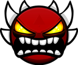
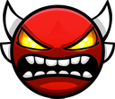
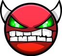

# Demon Saga 1: Sonic Wave

**From ClubStep Nightmares to Sonic Wave: the 2015 Demons List, beaten before Tride, plus Sonic Wave.**

<!-- VIDEO-LINK -->▶ **Watch the video:** _link goes here when it's live_<!-- /VIDEO-LINK -->

Every demon in the video, in the order I beat it, with the attempt count from the Level Complete screen, the level's current rating on the Geometry Dash servers, and stats pulled from my Death Tracker save.

## At a glance

- **38 demons** beaten between **March 19 2026** and **October 20 2026**
- **150,460 attempts** in total (Level Complete screens; Sonic Wave counts Start Pos + Normal)
-  4 Extreme ·  32 Insane ·  2 Hard
- Most attempts: **Sonic Wave** (38,016, Start Pos + Normal), then **The Ultimate Phase** (11,096) and **lezicuv** (9,598)

## Every level in the video, in the order beaten

| # | | Level | Creator | Rating | 2015 list | Attempts | Beaten | Song | Level ID |
|--:|:-:|---|---|---|:-:|--:|---|---|--:|
| 1 |  | **ClubStep Nightmares** | Zobros | Insane | — | 1,285 | March 19 2026 | dj-Nate - {dj-N} Robotic Nightmares | 7723236 |
| 2 |  | **Plasma Pulse** | Smokes & Giron | Insane | — | 1,908 | March 19 2026 | NemesisTheory - Show No Tears | 8148420 |
| 3 |  | **BuTiTi II** | JonathanGD | Insane | — | 3,561 | March 20 2026 | meganeko - Milkshake | 37259527 |
| 4 |  | **Chronos** | ViPriN | Hard | — | 461 | March 22 2026 | papkee - Timekeeper | 41893726 |
| 5 |  | **Buff This** | BoyoftheCones | Insane | — | 860 | March 23 2026 | ShutEye - Nerf This! (feat. D.Va) | 38306937 |
| 6 |  | **aftermath** | Exenity & more | Extreme | — | 7,579 | March 31 2026 | Dimrain47 - At the Speed of Light | 25610878 |
| 7 |  | **Melody of Violins** | WOOGI1411 | Insane | #40 | 697 | April 7 2026 | F-777 - Dance Of The Violins | 8304817 |
| 8 |  | **Firewall** | Hinds | Insane | #39 | 1,125 | April 9 2026 | Rukkus - ~NK~ Fracture | 13437081 |
| 9 |  | **Swing Squad** | Zobros | Insane | #38 | 2,223 | April 10 2026 | F-777 - Cane Swinging | 7285206 |
| 10 |  | **Crimson Clutter** | RedUniverse | Insane | #25 | 3,730 | April 11 2026 | Rukkus - ~NK~ "Sweet Dreams" FULL | 9700312 |
| 11 |  | **Galatic Fragility** | TeamSmokeWeed | Insane | #17 | 4,913 | May 21 2026 | TMM43 - [TMM43] Eurodancer | 9834617 |
| 12 |  | **The Ultimate Phase** | Andromeda & more | Extreme | #5 | 11,096 | May 23 2026 | Darkmetroidomega - The Final Phase | 7174110 |
| 13 |  | **Creeper Force** | CreeperMILK | Insane | #4 | 3,968 | May 28 2026 | Waterflame - Hexagon Force | 2487191 |
| 14 |  | **Future demoness** | MaJackO | Insane | #15 | 1,494 | May 30 2026 | Rudebrat - The Quick and the Dead | 9229228 |
| 15 |  | **MadHouse** | GREEN | Insane | #6 | 1,998 | June 2 2026 | Xtrullor - Screamroom | 11399086 |
| 16 |  | **Ruined Journey** | KeiAs | Insane | #9 | 3,423 | June 9 2026 | Dimrain47 - At the Speed of Light | 11433410 |
| 17 |  | **lezicuv** | Step4enko | Extreme | #10 | 9,598 | June 22 2026 | Rukkus - ~NK~ Fear Me (NGADm Entry) | 13314218 |
| 18 |  | **effot** | ozpectro | Insane | #11 | 6,988 | July 7 2026 | ForeverBound - Summer Breeze | 8164555 |
| 19 |  | **landect** | ozpectro | Insane | #12 | 2,447 | July 10 2026 | Dimrain47 - Forsaken Neon | 12314573 |
| 20 |  | **extreme chaos** | nether | Insane | #13 | 1,408 | July 11 2026 | DJVI - Can't Let Go | 2000451 |
| 21 |  | **Sequence** | WOOGI1411 | Insane | #14 | 3,793 | July 14 2026 | Lockyn - Sequence WIP | 7456327 |
| 22 |  | **Alphabet X** | BlackP2sFull | Insane | #16 | 3,525 | July 15 2026 | Waterflame - Electroman Adventures | 523638 |
| 23 |  | **Antique Circles** | LmAnubis | Insane | #18 | 3,528 | July 28 2026 | Rukkus - NK - Jawbreaker | 13641664 |
| 24 |  | **Twilight Step V2** | BlackP2sFull | Insane | #19 | 639 | July 29 2026 | DJVI - xStep | 698322 |
| 25 |  | **Pyromaniac** | Glittershroom | Insane | #20 | 2,238 | July 30 2026 | ParagonX9 - Infiltration | 10533089 |
| 26 |  | **UltraSonic** | ZenthicAlpha | Insane | #22 | 5,671 | August 21 2026 | F-777 - Sonic Blaster | 8491232 |
| 27 |  | **El Dorado** | LmAnubis | Insane | #23 | 1,299 | August 22 2026 | Waterflame - ThunderZone v2 | 11904920 |
| 28 |  | **Endorphin** | WOOGI1411 | Insane | #24 | 1,564 | August 23 2026 | megawolf77 - Cosmic Dolphin | 11992926 |
| 29 |  | **Colorful OverNight** | WOOGI1411 | Insane | #26 | 2,933 | August 25 2026 | Tobu - Colors | 7899562 |
| 30 |  | **Ultraviolet** | ViPriN & more | Insane | #27 | 1,343 | August 26 2026 | ParagonX9 - HyperioxX | 10288836 |
| 31 |  | **LightWave** | Splenetic | Insane | #28 | 2,121 | August 28 2026 | BoomKitty - Bass Knight | 9722097 |
| 32 |  | **Frozen Space** | Aquatias | Insane | #31 | 1,453 | August 29 2026 | DJ-Nate - Theory of Everything 2 | 8091369 |
| 33 |  | **Luminum** | Zobros | Insane | #32 | 3,238 | August 30 2026 | BoomKitty - Bass Knight | 12063209 |
| 34 |  | **Transonic** | WOOGI1411 | Insane | #33 | 1,597 | September 1 2026 | F-777 - Sonic Blaster | 12285628 |
| 35 |  | **Infernity** | Jo2000 | Hard | #35 | 652 | September 1 2026 | Xtrullor - NK - Nine Circles (Xtrullor Remix) | 13530154 |
| 36 |  | **The Shredder** | Sandstorm | Insane | #36 | 1,821 | September 2 2026 | Waterflame - The Shredder | 6404795 |
| 37 |  | **Plasma Pulse II** | Smokes & Giron | Insane | #37 | 4,267 | September 3 2026 | dj-Nate - {dj-N} Intercept 2 | 13457056 |
| 38 |  | **Sonic Wave** | Cyclic | Extreme | — | 38,016 (Start Pos + Normal) | October 20 2026 | F-777 - Sonic Blaster | 26681070 |

## The 2015 Demons List (Pointercrate, November 11, 2015)

The list as it stood on November 11, 2015. Ratings are the levels' current ones on the GD servers.

| Rank | | Level | Creator | Rating | Status |
|--:|:-:|---|---|---|---|
| 1 |  | **Bloodbath** | Riot | Extreme | Beaten before this video |
| 2 |  | **Cataclysm** | Ggb0y | Extreme | Beaten before this video |
| 3 |  | **ICE Carbon Diablo X** | roadbose | Insane | Beaten before this video |
| 4 |  | **Creeper Force** | CreeperMILK | Insane | Beaten in this video (#13, May 28 2026) |
| 5 |  | **The Ultimate Phase** | Andromeda GMD | Extreme | Beaten in this video (#12, May 23 2026) |
| 6 |  | **MadHouse** | GREEN | Insane | Beaten in this video (#15, June 2 2026) |
| 7 |  | **Necropolis** | IIINePtunEIII | Insane | Beaten before this video |
| 8 |  | **Demonic Bass** | Miniman2098 | Insane | Not in this video (Death Tracker shows a completion, but there's no recording) |
| 9 |  | **Ruined Journey** | KeiAs | Insane | Beaten in this video (#16, June 9 2026) |
| 10 |  | **lezicuv** | Step4enko | Extreme | Beaten in this video (#17, June 22 2026) |
| 11 |  | **effot** | ozpectro | Insane | Beaten in this video (#18, July 7 2026) |
| 12 |  | **landect** | ozpectro | Insane | Beaten in this video (#19, July 10 2026) |
| 13 |  | **extreme chaos** | nether | Insane | Beaten in this video (#20, July 11 2026) |
| 14 |  | **Sequence** | WOOGI1411 | Insane | Beaten in this video (#21, July 14 2026) |
| 15 |  | **Future demoness** | MaJackO | Insane | Beaten in this video (#14, May 30 2026) |
| 16 |  | **Alphabet X** | BlackP2sFull | Insane | Beaten in this video (#22, July 15 2026) |
| 17 |  | **Galatic Fragility** | TeamSmokeWeed | Insane | Beaten in this video (#11, May 21 2026) |
| 18 |  | **Antique Circles** | LmAnubis | Insane | Beaten in this video (#23, July 28 2026) |
| 19 |  | **Twilight Step V2** | BlackP2sFull | Insane | Beaten in this video (#24, July 29 2026) |
| 20 |  | **Pyromaniac** | Glittershroom | Insane | Beaten in this video (#25, July 30 2026) |
| 21 |  | **Rupture** | Jekko | Insane | Beaten before this video |
| 22 |  | **UltraSonic** | ZenthicAlpha | Insane | Beaten in this video (#26, August 21 2026) |
| 23 |  | **El Dorado** | LmAnubis | Insane | Beaten in this video (#27, August 22 2026) |
| 24 |  | **Endorphin** | WOOGI1411 | Insane | Beaten in this video (#28, August 23 2026) |
| 25 |  | **Crimson Clutter** | RedUniverse | Insane | Beaten in this video (#10, April 11 2026) |
| 26 |  | **Colorful OverNight** | WOOGI1411 | Insane | Beaten in this video (#29, August 25 2026) |
| 27 |  | **Ultraviolet** | ViPriN | Insane | Beaten in this video (#30, August 26 2026) |
| 28 |  | **LightWave** | Splenetic | Insane | Beaten in this video (#31, August 28 2026) |
| 29 |  | **8o** | Zobros | Insane | Beaten before this video |
| 30 |  | **Supersonic** | ZenthicAlpha | Insane | Beaten before this video |
| 31 |  | **Frozen Space** | Aquatias | Insane | Beaten in this video (#32, August 29 2026) |
| 32 |  | **Luminum** | Zobros | Insane | Beaten in this video (#33, August 30 2026) |
| 33 |  | **Transonic** | WOOGI1411 | Insane | Beaten in this video (#34, September 1 2026) |
| 34 |  | **Acropolis** | Zobros | Insane | Beaten before this video |
| 35 |  | **Infernity** | Jo2000 | Hard | Beaten in this video (#35, September 1 2026) |
| 36 |  | **The Shredder** | Sandstorm | Insane | Beaten in this video (#36, September 2 2026) |
| 37 |  | **Plasma Pulse II** | Giron | Insane | Beaten in this video (#37, September 3 2026) |
| 38 |  | **Swing Squad** | Zobros | Insane | Beaten in this video (#9, April 10 2026) |
| 39 |  | **Firewall** | Hinds | Insane | Beaten in this video (#8, April 9 2026) |
| 40 |  | **Melody of Violins** | WOOGI1411 | Insane | Beaten in this video (#7, April 7 2026) |

## Levels in the video that aren't on that list

These were beaten in the same stretch and are in the video too:

-  **ClubStep Nightmares** by Zobros: 1,285 attempts, beaten March 19 2026
-  **Plasma Pulse** by Smokes & Giron: 1,908 attempts, beaten March 19 2026
-  **BuTiTi II** by JonathanGD: 3,561 attempts, beaten March 20 2026
-  **Chronos** by ViPriN: 461 attempts, beaten March 22 2026
-  **Buff This** by BoyoftheCones: 860 attempts, beaten March 23 2026
-  **aftermath** by Exenity & more: 7,579 attempts, beaten March 31 2026
-  **Sonic Wave** by Cyclic: 38,016 (Start Pos + Normal) attempts, beaten October 20 2026

## Death Tracker stats

From the [Death Tracker](https://geode-sdk.org/mods/elohmrow.death_tracker) mod's save on my PC. Its attempt counts can differ a little from the Level Complete screen (it only counts attempts made while the mod was installed). "Best from 0%" is the furthest normal-mode run before the completion; "most deaths" is the percentage I died at most often from 0%.

| # | Level | Tracked attempts | Deaths from 0% | Best from 0% | Most deaths at | Sessions |
|--:|---|--:|--:|--:|---|--:|
| 1 | ClubStep Nightmares | 1,289 | 336 | 90% | 5% (35), 14% (29) | 23 |
| 2 | Plasma Pulse | 1,908 | 425 | 94% | 24% (44), 61% (28) | 20 |
| 3 | BuTiTi II | 3,561 | 546 | 84% | 13% (91), 17% (72) | 100 |
| 4 | Chronos | 461 | 133 | 63% | 2% (24), 29% (13) | 30 |
| 5 | Buff This | 860 | 398 | 82% | 2% (72), 1% (65) | 24 |
| 6 | aftermath | 7,579 | 2,164 | 88% | 3% (130), 2% (126) | 145 |
| 7 | Melody of Violins | 697 | 99 | 57% | 2% (14), 25% (12) | 11 |
| 8 | Firewall | 1,125 | 138 | 59% | 2% (24), 0% (11) | 12 |
| 9 | Swing Squad | 2,223 | 580 | 98% | 2% (70), 5% (41) | 29 |
| 10 | Crimson Clutter | 3,730 | 1,285 | 75% | 5% (182), 39% (152) | 81 |
| 11 | Galatic Fragility | 4,913 | 1,251 | 93% | 10% (304), 14% (126) | 78 |
| 12 | The Ultimate Phase | 11,096 | 1,448 | 91% | 1% (316), 14% (133) | 111 |
| 13 | Creeper Force | 3,968 | 605 | 74% | 1% (87), 36% (49) | 55 |
| 14 | Future demoness | 1,494 | 616 | 77% | 3% (67), 7% (67) | 22 |
| 15 | MadHouse | 1,998 | 772 | 70% | 1% (143), 2% (128) | 50 |
| 16 | Ruined Journey | 3,423 | 917 | 80% | 1% (131), 5% (95) | 102 |
| 17 | lezicuv | 9,598 | 2,338 | 83% | 33% (302), 2% (246) | 178 |
| 18 | effot | 6,988 | 2,200 | 95% | 4% (191), 8% (184) | 133 |
| 19 | landect | 2,447 | 751 | 98% | 16% (94), 10% (93) | 46 |
| 20 | extreme chaos | 1,408 | 134 | 81% | 23% (15), 5% (15) | 18 |
| 21 | Sequence | 3,793 | 721 | 65% | 4% (174), 2% (138) | 33 |
| 22 | Alphabet X | 3,525 | 1,202 | 89% | 2% (303), 3% (235) | 51 |
| 23 | Antique Circles | 3,528 | 1,396 | 89% | 1% (342), 2% (265) | 89 |
| 24 | Twilight Step V2 | 638 | 510 | 98% | 4% (140), 11% (84) | 39 |
| 25 | Pyromaniac | 2,186 | 729 | 79% | 18% (222), 10% (85) | 48 |
| 26 | UltraSonic | 5,655 | 1,391 | 91% | 6% (575), 1% (182) | 123 |
| 27 | El Dorado | 1,151 | 418 | 80% | 9% (70), 2% (68) | 24 |
| 28 | Endorphin | 1,543 | 155 | 92% | 5% (50), 10% (29) | 20 |
| 29 | Colorful OverNight | 2,870 | 408 | 85% | 2% (56), 17% (46) | 59 |
| 30 | Ultraviolet | 1,323 | 241 | 45% | 1% (30), 8% (23) | 29 |
| 31 | LightWave | 2,054 | 1,061 | 93% | 9% (143), 22% (114) | 27 |
| 32 | Frozen Space | 1,444 | 293 | 90% | 1% (55), 11% (23) | 20 |
| 33 | Luminum | 3,237 | 570 | 97% | 5% (188), 15% (67) | 32 |
| 34 | Transonic | 1,574 | 369 | 83% | 18% (51), 6% (33) | 25 |
| 35 | Infernity | 643 | 357 | 74% | 15% (33), 16% (33) | 17 |
| 36 | The Shredder | 1,804 | 243 | 82% | 7% (37), 3% (26) | 33 |
| 37 | Plasma Pulse II | 4,266 | 1,782 | 94% | 2% (459), 0% (149) | 89 |
| 38 | Sonic Wave | 29,482 | 9,595 | 93% | 1% (4,082), 0% (810) | 662 |

## Gear and tools

- **Keyboard:** MCHOSE Ace 68 Turbo (16K polling rate)
- **Recording:** [Source Record](https://obsproject.com/forum/resources/source-record.1285/) OBS plugin by Exeldro
- **Input display:** [JKPS](https://github.com/Tonetfal/JKPS) by Tonetfal
- **Song endings:** [Custom Song Fade](https://geode-sdk.org/mods/bobby_shmurner.custom-song-fade) Geode mod by BobbyShmurner
- **Stats:** [Death Tracker](https://geode-sdk.org/mods/elohmrow.death_tracker) Geode mod by elohmrow

## Sources

- Ratings: the GD servers via [GDBrowser](https://gdbrowser.com/), checked October 22, 2026.
- The 2015 list: the Pointercrate tab of the community *Demonlist Archive* spreadsheet (November 11, 2015 column).
- Attempts and dates: the Level Complete screen and the recording timestamps (times are Pacific).
